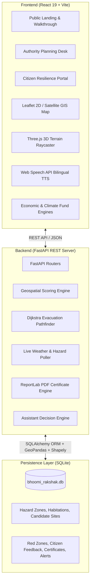
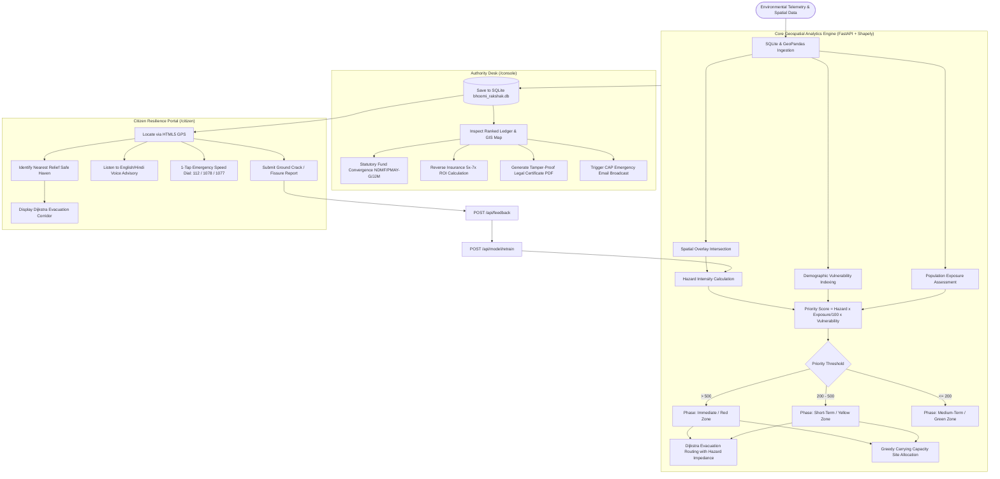
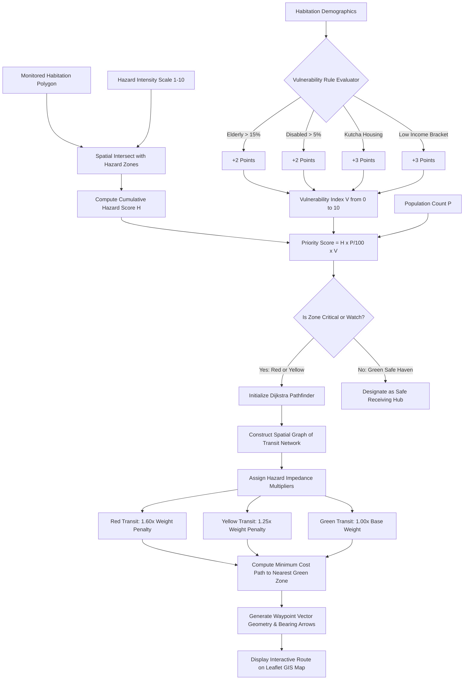
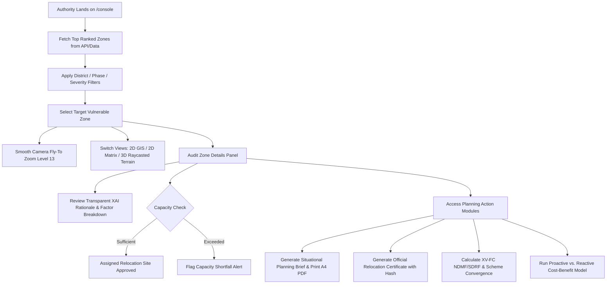
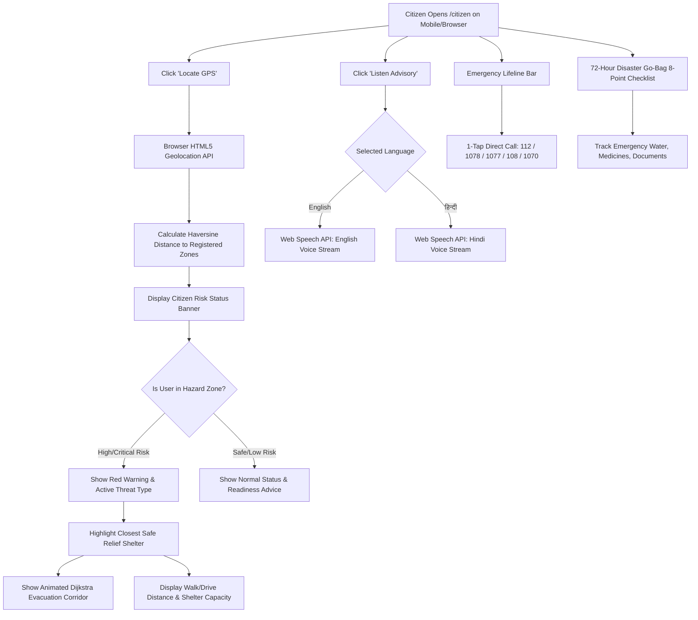
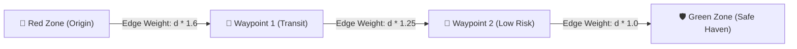

# Bhoomi Rakshak 2.0 — Technical Architecture & Complete Working Guide

> **Bhoomi Rakshak 2.0** — AI-assisted disaster-risk and relocation decision support

**Bhoomi Rakshak** is an AI-assisted geospatial disaster-risk mitigation, evacuation routing, and proactive relocation planning platform built for the AZINHACK '26 open-innovation round. It combines structured project knowledge with TinyFish live-web research when current external evidence is needed.

The system empowers district disaster management authorities (DDMAs), state agencies (SDMAs), urban local bodies, and vulnerable citizens with explainable decision support, multi-modal GIS visualization, algorithmic evacuation routing, and economic justification modeling.

## AZINHACK '26 Ready

This repository includes a focused [AZINHACK '26 submission pack](AZINHACK_SUBMISSION.md) with the judging map, TinyFish integration explanation, timed demo flow, setup commands, and final submission checklist.

TinyFish is integrated as a functional live-web research layer: the assistant checks internal Bhoomi Rakshak knowledge first, then uses TinyFish for current or uncovered disaster-risk questions. See [TINYFISH_README.md](TINYFISH_README.md) for the integration architecture and demo steps. The dedicated research workspace is available at `/intel`.

---

## 📑 Table of Contents

1. [High-Level Architecture](#1-high-level-architecture)
2. [Technology Stack: Where Does Which Tech Do What?](#2-technology-stack-where-does-which-tech-do-what)
   - [A. Technology Stack Mapping Matrix](#a-technology-stack-mapping-matrix)
   - [B. Detailed Technology-by-Technology Breakdown](#b-detailed-technology-by-technology-breakdown)
3. [End-to-End System Working Flowcharts](#3-end-to-end-system-working-flowcharts)
   - [A. Comprehensive End-to-End System Flowchart](#a-comprehensive-end-to-end-system-flowchart)
   - [B. Geospatial Scoring & Evacuation Routing Flowchart](#b-geospatial-scoring--evacuation-routing-flowchart)
   - [C. Authority Planning Desk Workflow (`/console`)](#c-authority-planning-desk-workflow-console)
   - [D. Citizen Resilience & Emergency Navigation Flowchart (`/citizen`)](#d-citizen-resilience--emergency-navigation-flowchart-citizen)
   - [E. Continuous Feedback & Model Retraining Loop Flowchart](#e-continuous-feedback--model-retraining-loop-flowchart)
4. [Database Layer (SQLite Architecture)](#4-database-layer-sqlite-architecture)
5. [Backend Engine & Working (FastAPI + Geospatial Stack)](#5-backend-engine--working-fastapi--geospatial-stack)
6. [Core Algorithmic Engines](#6-core-algorithmic-engines)
   - [A. Priority Scoring & Normalization Engine](#a-priority-scoring--normalization-engine)
   - [B. Multi-Hazard Live Fusion Engine](#b-multi-hazard-live-fusion-engine)
   - [C. Dijkstra Shortest-Path Evacuation Engine](#c-dijkstra-shortest-path-evacuation-engine)
   - [D. Multi-Factor Relocation Site Suitability Index](#d-multi-factor-relocation-site-suitability-index)
   - [E. Reverse Insurance & Economic Resilience Calculus](#e-reverse-insurance--economic-resilience-calculus)
   - [F. Climate Fund & Statutory Grant Convergence Calculator](#f-climate-fund--statutory-grant-convergence-calculator)
   - [G. XGBoost NLP Decision & Assistant Engine](#g-xgboost-nlp-decision--assistant-engine)
   - [H. Zone-Adaptive Evacuation & "You Are Safe" Logic](#h-zone-adaptive-evacuation--you-are-safe-logic)
7. [Frontend Layer & Component Mechanics (React + Vite)](#7-frontend-layer--component-mechanics-react--vite)
   - [Authority Planning Desk (`/console`)](#authority-planning-desk-console)
   - [Citizen Resilience Portal (`/citizen`)](#citizen-resilience-portal-citizen)
   - [Interactive 3D Geological Terrain (`Terrain3D` / Three.js)](#interactive-3d-geological-terrain-terrain3d--threejs)
   - [Tri-Tier Bilingual Voice Advisory (Web Speech API)](#tri-tier-bilingual-voice-advisory-web-speech-api)
   - [AI Assistant & Decision Support](#ai-assistant--decision-support)
   - [Complete Mobile-First Responsive Design & Fluid Geometry](#complete-mobile-first-responsive-design--fluid-geometry)
8. [API Reference](#8-api-reference)
9. [Installation & Local Setup](#9-installation--local-setup)

---

## 1. High-Level Architecture

The system operates as a decoupled client-server architecture with a local, zero-config **SQLite** database engine:



---

## 2. Technology Stack: Where Does Which Tech Do What?

### A. Technology Stack Mapping Matrix

| Technology                           | Category                    | Where Used (File / Module)                                                 | What It Does (Role & Mechanics)                                                                                                                                                 |
| ------------------------------------ | --------------------------- | -------------------------------------------------------------------------- | ------------------------------------------------------------------------------------------------------------------------------------------------------------------------------- |
| **React 19**                         | Frontend Framework          | `src/App.jsx`, `src/pages/*.jsx`, `src/components/*.jsx`                   | Drives reactive component rendering, state isolation (`useState`, `useEffect`, `useMemo`), and concurrent UI transitions.                                                       |
| **Vite**                             | Build Tool & Dev Server     | `vite.config.js`, `package.json`                                           | Powers instant sub-second Hot Module Replacement (HMR), tree-shaking, and optimized production bundle code-splitting.                                                           |
| **React Router**                     | Client-side Routing         | `src/App.jsx`                                                              | Enables seamless, deep-linkable multi-route SPA navigation across `/`, `/console`, `/citizen`, `/dashboard`, and fallback 404 views without page reloads.                       |
| **Leaflet & React-Leaflet**          | 2D Interactive GIS          | `src/components/Map.jsx`, `src/pages/Website.jsx`                          | Renders interactive vector tile maps, polygon risk overlays, marker clusters, and animated Dijkstra evacuation polylines with click-to-fly zoom triggers.                       |
| **Esri World Imagery**               | Satellite GIS Layer         | `src/components/Map.jsx`, `src/pages/Website.jsx`                          | Streams ultra-high-resolution satellite aerial basemaps allowing authorities and citizens to inspect real-world physical terrain, rivers, and slopes.                           |
| **Three.js & React Three Fiber**     | 3D WebGL Graphics           | `src/components/Earth3D.jsx`, `src/pages/Website.jsx`                      | Raycasts 3D Digital Elevation Models (DEM), generates procedural contour topographies and geological fault lines with smooth orbital camera controls.                           |
| **Recharts**                         | Data Visualization          | `src/components/AnalyticsPanel.jsx`, `src/components/ReverseInsurance.jsx` | Renders responsive SVG charts (radar multi-factor distributions, priority curves, 10-year proactive vs. reactive cost-benefit trajectories).                                    |
| **Lucide React**                     | UI Iconography              | All frontend pages & components                                            | Supplies crisp, high-contrast SVG icons for hazard badges (flood, landslide, cyclone), transportation routes, accessibility buttons, and emergency lifelines.                   |
| **Web Speech API**                   | Voice Synthesis (TTS)       | `src/pages/Website.jsx`                                                    | Native browser speech synthesizer (`SpeechSynthesisUtterance`) that broadcasts spoken disaster advisories in English and हिन्दी (Hindi).                                        |
| **HTML5 Geolocation**                | User Positioning            | `src/pages/Website.jsx`                                                    | Extracts citizen latitude/longitude via `navigator.geolocation` to compute real-time Haversine distance to nearest hazard zones and designated relief shelters.                 |
| **Vanilla CSS & Print CSS**          | Styling & Document Engine   | `src/index.css`, `src/App.css`                                             | Implements glassmorphism UI, responsive dark/light color palettes, and pure `@media print` DOM isolation for single-page A4 PDF/paper export.                                   |
| **Axios**                            | HTTP Client                 | `src/services/api.js`                                                      | Dispatches asynchronous REST API calls to FastAPI endpoints (`/api/layers/*`, `/api/engine/*`, `/api/feedback`, `/api/model/retrain`).                                          |
| **FastAPI**                          | Backend REST API            | `backend/app/main.py`                                                      | Asynchronous, high-throughput Python API server with automated OpenAPI/Swagger documentation, request validation, and routing.                                                  |
| **Uvicorn**                          | ASGI Web Server             | `backend/app/main.py`                                                      | Production-grade ASGI server delivering high-concurrency request handling on port `8000`.                                                                                       |
| **SQLite**                           | Database Persistence        | `bhoomi_rakshak.db`, `backend/app/database.py`                             | Zero-configuration, serverless, ACID-compliant local SQL database storing spatial boundaries, habitations, candidate sites, and logs.                                           |
| **SQLAlchemy ORM**                   | Data Modeling & Queries     | `backend/app/models.py`, `backend/app/crud.py`                             | Python ORM mapping SQL tables to Python objects, managing relational foreign keys, transactions, and session connection pools.                                                  |
| **GeoPandas & Shapely**              | Geospatial Engine           | `backend/app/engine.py`, `scripts/seed_data.py`                            | Computes geometric spatial intersections (`overlay`), coordinate transformations, polygon containment, and geospatial impedance matrices.                                       |
| **Pandas & NumPy**                   | Statistical Analysis        | `backend/app/engine.py`                                                    | Executes vector demographic calculations, vulnerability index matrices, population exposure normalizations, and priority ranking.                                               |
| **ReportLab**                        | PDF Generation              | `backend/app/pdf_gen.py`                                                   | Programmatically draws official government-style relocation certificates with seals, structured data tables, and SHA-256 tamper-evident hashes.                                 |
| **Pydantic**                         | Schema Validation           | `backend/app/schemas.py`                                                   | Enforces strict JSON payload structure, type coercion, and schema verification for all incoming API requests and outgoing responses.                                            |
| **XGBoost & Scikit-learn**           | Machine Learning NLP Engine | `backend/app/chatbot.py`, `backend/train_chatbot.py`                       | Gradient-boosted decision trees over TF-IDF n-gram text vectors classify queries into disaster mitigation intents with calibrated probabilities and automated keyword fallback. |
| **Mobile-First CSS & Media Queries** | Responsive Layout Engine    | `frontend/src/index.css`, `Website.jsx`, `Dashboard.jsx`                   | Delivers zero-overflow responsive geometry across 360px–980px+ viewports, reordering GIS maps ahead of lists on phones and sizing touch targets.                                |
| **Python-dotenv**                    | Config Management           | `backend/app/main.py`                                                      | Manages environment configurations securely from `.env` files.                                                                                                                  |

---

### B. Detailed Technology-by-Technology Breakdown

#### 1. React 19 & Vite (Frontend Core)

- **Where**: `frontend/src/App.jsx`, `frontend/src/pages/Website.jsx`, `frontend/src/pages/Dashboard.jsx`.
- **What It Does**:
  - Manages deep UI state (active hazard zone, active filters, bilingual selection, scenario progress).
  - Uses `useMemo` for heavy calculations (e.g., filtering 1,000 synthetic zones in milliseconds).
  - Uses `useEffect` with clean debounce timers for window resizing and live priority score simulations.
  - Vite provides sub-second build times and HMR (Hot Module Replacement) during development.

#### 2. Leaflet & Esri Satellite Layers (Geospatial Mapping)

- **Where**: `frontend/src/components/Map.jsx`, `frontend/src/pages/Website.jsx`.
- **What It Does**:
  - Renders multi-layer maps: OpenStreetMap (Standard), Esri High-Resolution World Imagery (Satellite), and Esri Topo (Terrain contours).
  - Renders 400+ color-coded circular risk markers (Red for Immediate, Yellow for Short-Term, Green for Safe Havens).
  - Dynamically draws animated SVG Dijkstra evacuation corridors with waypoint nodes and directional arrows.
  - Smooth camera panning with `map.flyTo([lat, lng], 13)` when any zone is clicked.

#### 3. Three.js (3D Geological Terrain)

- **Where**: `frontend/src/components/Earth3D.jsx`, `frontend/src/pages/Website.jsx`.
- **What It Does**:
  - Creates a WebGL scene raycasting elevation heightmaps into a 3D terrain mesh.
  - Generates topographic elevation curves, geological fault lines, and clickable hazard pins.
  - Allows full 3D camera orbital rotation, panning, and zooming.

#### 4. Web Speech API (Bilingual Emergency Voice Synthesizer)

- **Where**: `frontend/src/pages/Website.jsx`.
- **What It Does**:
  - Utilizes browser native `window.speechSynthesis` with `SpeechSynthesisUtterance`.
  - Parses current emergency advisory text into localized voice streams in English (`en-IN` / `en-US`) and Hindi (`hi-IN`).
  - Animates dynamic CSS soundwave bars during speech playback.

#### 5. FastAPI & Uvicorn (Backend API Service)

- **Where**: `backend/app/main.py`.
- **What It Does**:
  - Exposes RESTful endpoints for GIS layers, analytics scoring, citizen feedback, retraining, and PDF generation.
  - Runs CORS middleware allowing direct frontend communication.
  - Automatically generates interactive OpenAPI documentation at `/docs`.

#### 6. SQLite & SQLAlchemy (Zero-Config Database)

- **Where**: `backend/app/database.py`, `backend/app/models.py`, `backend/app/crud.py`.
- **What It Does**:
  - Stores all persistent state in a single local database file (`bhoomi_rakshak.db`).
  - SQLAlchemy ORM manages tables (`hazard_zones`, `habitations`, `candidate_sites`, `red_zones`, `feedback`, `legal_certificates`).
  - Stores spatial geometries as GeoJSON text and queries them with zero external server dependencies.

#### 7. GeoPandas & Shapely (Geospatial Engine)

- **Where**: `backend/app/engine.py`, `scripts/seed_data.py`.
- **What It Does**:
  - Converts GeoJSON database strings into `Shapely` geometric polygons (`Polygon`, `Point`, `MultiPolygon`).
  - Executes spatial overlays (`gpd.overlay(habs, hazards, how='intersection')`) to detect spatial overlaps between monitored settlements and active disaster hazard zones.

#### 8. ReportLab (Cryptographic PDF Generation)

- **Where**: `backend/app/pdf_gen.py`.
- **What It Does**:
  - Programmatically constructs official A4 Government of India style relocation certificates.
  - Embeds official emblems, priority metrics, assigned relocation site data, authorized signature blocks, and cryptographic SHA-256 tamper-evident verification hashes.

---

## 3. End-to-End System Working Flowcharts

### A. Comprehensive End-to-End System Flowchart

This flowchart outlines the entire operational lifecycle from raw environmental data ingestion to administrative action and citizen emergency response:



---

### B. Geospatial Scoring & Evacuation Routing Flowchart



---

### C. Authority Planning Desk Workflow (`/console`)



---

### D. Citizen Resilience & Emergency Navigation Flowchart (`/citizen`)



---

### E. Continuous Feedback & Model Retraining Loop Flowchart

```mermaid
flowchart LR
    subgraph GroundReality ["Grassroots Field Input"]
        Citizen[Citizen / Ward Officer] -->|Upload Observations| ReportForm[Observation Form: Fissures, Cracks, Seepage]
        ReportForm --> AntiSpam[Honeypot Validation & Phone Capture]
        AntiSpam --> APIPost[POST /api/feedback]
    end

    subgraph StoragePipeline ["Persistence & Calibration"]
        APIPost --> SQLite[(SQLite Table: feedback)]
        SQLite --> TriggerRetrain[POST /api/model/retrain]
        TriggerRetrain --> Recalibrate[Dynamic Weight Adjustment Algorithm]
    end

    subgraph UpdatedScoring ["Updated Live Scoring"]
        Recalibrate --> FormulaUpdate["H = (0.30 x L) + (0.25 x S) + (0.20 x R) + (0.15 x G) + (0.10 x V)"]
        FormulaUpdate --> EngineRecalc[Re-run Geospatial Scoring Engine]
        EngineRecalc --> UpdatedRedZones[Updated Red Zones & Priority Order]
    end
```



---

## 4. Database Layer (SQLite Architecture)

The system uses a pure, local file-based **SQLite** database (`bhoomi_rakshak.db`) without external server overhead or container requirements.

### Why SQLite?

- **Zero Configuration**: No external daemon, port management, or Docker dependencies needed.
- **Portability**: Database runs as a single file on local disk with instant cold-start time.
- **High Concurrency for Read Queries**: Supports multi-threaded reads via SQLAlchemy's `check_same_thread=False` engine pool.
- **GeoJSON Native Storage**: Geospatial geometries (polygons, corridors, coordinates) are stored as GeoJSON text and parsed into `Shapely` geometry objects dynamically for spatial analytics.

### Database Schema

| Table                | Purpose                                            | Key Attributes                                                                                                                                                                      |
| -------------------- | -------------------------------------------------- | ----------------------------------------------------------------------------------------------------------------------------------------------------------------------------------- |
| `hazard_zones`       | Spatial boundaries & hazard telemetry              | `id`, `hazard_type`, `intensity` (1–10), `historical_casualties`, `geom` (GeoJSON)                                                                                                  |
| `habitations`        | Community settlements & demographic vulnerability  | `id`, `name`, `population`, `elderly_pct`, `disabled_pct`, `income_bracket`, `housing_quality`, `occupation_type`, `dependency_ratio`, `geom`                                       |
| `candidate_sites`    | Evaluated relocation destinations                  | `id`, `name`, `max_capacity`, `water_availability`, `power_availability`, `sanitation`, `proximity_to_services`, `geom`                                                             |
| `red_zones`          | Algorithmic scoring output & action prioritization | `id`, `habitation_id`, `hazard_score`, `vulnerability_score`, `exposure_score`, `priority_score`, `phase` (Immediate/Short-Term/Medium-Term), `assigned_site_id`, `xai_explanation` |
| `feedback`           | Citizen ground truth observations & crowd reports  | `id`, `red_zone_id`, `citizen_name`, `message`, `timestamp`                                                                                                                         |
| `legal_certificates` | Generated official relocation certificates         | `id`, `red_zone_id`, `pdf_hash`, `issue_date`                                                                                                                                       |
| `alert_emails`       | Emergency notification subscriber lists            | `id`, `email`, `created_at`                                                                                                                                                         |

---

## 5. Backend Engine & Working (FastAPI + Geospatial Stack)

The backend (`backend/app/`) is powered by Python and FastAPI:

1. **`main.py`**: Initializes the FastAPI application, mounts CORS middleware, provisions SQLite tables via `models.Base.metadata.create_all()`, and exposes REST endpoints.
2. **`database.py`**: Configures SQLAlchemy engine with `sqlite:///./bhoomi_rakshak.db`.
3. **`models.py`**: Declares SQLAlchemy ORM schema models and relational foreign keys.
4. **`engine.py`**: Executes the spatial overlay, vulnerability indexing, priority scoring, and greedy carrying-capacity allocation using `GeoPandas`, `Shapely`, and `Pandas`.
5. **`pdf_gen.py`**: Uses `ReportLab` to compile tamper-evident, watermarked official PDF relocation certificates with cryptographic SHA-256 verification hashes.
6. **`chatbot.py`**: Provides contextual decision-support guidance for disaster management protocols and evacuation logistics.
7. **`live_feeds.py`**: Simulates and integrates live environmental telemetry feeds into the priority recalculation pipeline.

---

## 6. Core Algorithmic Engines

### A. Priority Scoring & Normalization Engine

The engine identifies communities at risk using a deterministic, explainable mathematical formulation:

$$\text{Priority Score} = \text{Hazard Intensity} \times \left(\frac{\text{Population Exposure}}{100}\right) \times \text{Vulnerability Index}$$

#### Vulnerability Index Breakdown:

The vulnerability index ($V \in [0, 10]$) aggregates social and infrastructural fragility:

- Elderly population $> 15\% \rightarrow +2$ points
- Persons with disabilities $> 5\% \rightarrow +2$ points
- Kutcha / mud-thatch housing $\rightarrow +3$ points
- Low-income bracket $\rightarrow +3$ points

#### Phased Action Categorization:

- **`Immediate` (Red Zone)**: Priority Score $> 500$ — Urgent structural/life-safety threat; immediate evacuation corridor activated.
- **`Short-Term` (Yellow Zone)**: $200 < \text{Priority Score} \le 500$ — Elevated hazard threshold; site preparation and staged relocation required.
- **`Medium-Term` (Green Safe Zone)**: $\text{Priority Score} \le 200$ — Low-risk receiving zone with intake capacity.

---

### B. Multi-Hazard Live Fusion Engine

When multiple overlapping hazards affect a single habitation (e.g., riverine flood + slope instability + seismic activity), the system applies a multi-hazard fusion calculation:

$$\text{Composite Risk} = \min\left(100, \; \text{Mean}(\text{Active Hazard Scores}) + \text{Overlap Bonus}\right)$$

Where:

- $\text{Overlap Bonus} = (\text{Number of Active Hazards} - 1) \times 12.5$

---

### C. Dijkstra Shortest-Path Evacuation Engine

The platform routes endangered communities from high-risk origin zones to the nearest safe receiving zones using **Dijkstra's Algorithm with Dynamic Hazard Impedance**:



#### Hazard Impedance Weighting:

Each transit edge between spatial nodes has an effective cost:

$$W = \text{Geodesic Distance (km)} \times \text{Impedance Multiplier}$$

- **Red Corridor Impedance**: $1.60\times$ penalty (avoids active disaster paths).
- **Yellow Corridor Impedance**: $1.25\times$ penalty.
- **Green Safe Corridor Impedance**: $1.00\times$ standard weight.

The algorithm guarantees the path computed is not only geographically short, but minimizes exposure to active hazard zones during evacuation.

---

### D. Multi-Factor Relocation Site Suitability Index

Each candidate relocation destination is evaluated across 8 statutory suitability criteria:

$$\text{Suitability Score} = \frac{1}{8} \sum_{i=1}^{8} \text{Factor Score}_i$$

1. **Hazard Safety**: Distance from known active fault lines and floodplains.
2. **Carrying Capacity**: Land availability versus incoming population count.
3. **Road Accessibility**: Proximity to all-weather state/national highways.
4. **Water Availability**: Jal Jeevan Mission piped water or perennial aquifers.
5. **Healthcare Access**: Transit time to Primary Health Centres (PHCs) or District Hospitals.
6. **Education Access**: Proximity to primary and secondary schools.
7. **Livelihood Continuity**: Agricultural land or industrial employment access.
8. **Habitation Proximity**: Distance from original cultural and ancestral roots.

**Classification**:

- `80 – 100`: **Highly Suitable** (Fast-track clearance)
- `60 – 79`: **Suitable with Improvements** (Requires infrastructure pre-requisites)
- `< 60`: **Not Suitable** (Rejection / Alternative search)

---

### E. Reverse Insurance & Economic Resilience Calculus

Quantifies the financial return of proactive planned relocation versus reactive post-disaster expenditure:

```
Proactive Relocation Cost (Planned) = Land Acquisition + Resilient Housing + Basic Utilities + Livelihood Grants
Reactive Disaster Cost (Emergency)  = NDRF Deployment + Emergency Relief Camps + Reconstruction + Ex-Gratia + Economic Loss

Net Public Savings = Reactive Cost - Proactive Cost
ROI Multiplier     = Reactive Cost / Proactive Cost  (Typically 4.8x - 7.2x)
```

The system computes monthly delay cost penalties ($\approx 1.8\% \text{ compounding/month}$) demonstrating that early administrative action conserves state disaster mitigation funds.

---

### F. Climate Fund & Statutory Grant Convergence Calculator

Operationalizes official Indian disaster mitigation and development financing frameworks:

- **15th Finance Commission (XV-FC)**: National Disaster Mitigation Fund (NDMF) & State Disaster Mitigation Fund (SDMF/SDRF).
- **Multi-Scheme Convergence Engine**:
  - **PMAY-G** (Pradhan Mantri Awas Yojana - Gramin): ₹1.30 Lakh/household housing subsidy.
  - **JJM** (Jal Jeevan Mission): ₹15,000/household potable piped water connection.
  - **PMGSY** (Pradhan Mantri Gram Sadak Yojana): All-weather approach road development.
  - **MGNREGA**: 100-day wage component for site leveling and green belt development.
- **Center-State Fiscal Ratios**:
  - Special Category / Himalayan States (Uttarakhand, HP, NE): **90:10** Center:State.
  - General Category States: **75:25** Center:State.

---

### G. XGBoost NLP Decision & Assistant Engine

The system features an autonomous, offline-capable conversational AI assistant (`/api/chat`) driven by **XGBoost** and **Scikit-learn**:

- **Expanded Supervised Corpus**: Trained on over **210+ verified query-intent pairs** covering all technical and operational dimensions:
  - Geospatial Priority Scoring ($H$-formula weights and demographic vulnerability).
  - Multi-Hazard Live Fusion matrix and sensor telemetry thresholds.
  - Dijkstra pathfinding algorithm, network nodes, and impedance metrics.
  - Reverse Insurance economics, cost-of-delay formulas, and ROI calculations.
  - Statutory 15th FC migration funding rules (NDMF, SDMF, PMAY-G, JJM).
  - System architecture, SQLite spatial schema, and technical stack details.
- **Model Pipeline**:
  - `TfidfVectorizer(ngram_range=(1, 2), max_features=1200, sublinear_tf=True)` transforms raw queries into rich n-gram feature vectors.
  - `XGBClassifier(n_estimators=150, max_depth=6, learning_rate=0.08, eval_metric="mlogloss")` outputs class probability distributions across 12 distinct decision intents.
- **Calibrated Prediction with Keyword Fallback**:
  - Probability threshold is calibrated to `0.25` for high-recall intent identification.
  - Dual-layer keyword match fallback guarantees that domain terminology (e.g., "dijkstra", "reverse insurance", "priority score", "tech stack", "formula") always routes to the correct structured response even for novel phrasing.

---

### H. Zone-Adaptive Evacuation & "You Are Safe" Logic

Evacuation guidance adaptively branches based on zone classification:

- **Red Immediate Danger Zones**: Triggers high-urgency multi-hop Dijkstra corridor routing to designated green havens with hospital capacity, shelter beds, and ETA calculations.
- **Yellow Watch Zones**: Activates heightened vigilance protocols, go-bag preparedness reminders, and early transit route standby.
- **Green Safe Zones**: Evacuation routing is intentionally suppressed. Instead, the UI displays a reassuring **"✅ You Are Safe"** status banner confirming the area is stable and ready to serve as a receiving safe haven for evacuees from neighboring hazard sectors.

---

## 7. Frontend Layer & Component Mechanics (React + Vite)

### Authority Planning Desk (`/console`)

- **Ranked Red-Zone Ledger**: Dynamic pagination, multi-level district filtering, search by village name, and quick-fly map triggers.
- **Live Decision Panel**: Explains priority formulas, vulnerability indicators, historical disaster event logs, and carrying capacity status.
- **Print Isolation System**: Pure CSS `@media print` isolation that outputs clean single-page A4 administrative planning briefs and legal certificates without UI clipping.

### Citizen Resilience Portal (`/citizen`)

- **Geolocation Snapping**: Uses browser HTML5 Geolocation API (`navigator.geolocation`) to find user coordinates and identify the nearest registered hazard zone and designated safe haven.
- **SOS Speed-Dial Quick Strip**: Direct `tel:` mobile triggers to `112` (National Helpline), `1078` (NDRF), `1077` (DDMA), `108` (Ambulance), and `1070` (SDMA).
- **Interactive 72-Hour Go-Bag Checklist**: Client-persisted checklist tracking emergency survival supplies.
- **Citizen Ground Observation Hub**: Allows citizens to submit geo-tagged observations of ground cracks, slope fissures, and waterlogging.

### Interactive 3D Geological Terrain (`Terrain3D` / Three.js)

- Renders high-fidelity digital elevation models (DEM) using WebGL via Three.js.
- Generates procedural contour lines, geological fault lines, and interactive spatial pins with camera orbit fly-to animations.

### Tri-Tier Bilingual Voice Advisory (Web Speech API)

- Implements browser native `window.speechSynthesis` with `SpeechSynthesisUtterance`.
- Broadcasts context-aware voice advisories in **English** and **हिन्दी (Hindi)** with real-time waveform audio visualizers:
  - **Red Alert Message**: _"Immediate evacuation alert for [Zone]. Please follow the designated Dijkstra evacuation corridor to safe haven."_
  - **Yellow Alert Message**: _"Preparedness alert for [Zone]. The area is currently under close observation. Keep your 72-hour emergency go-bag ready."_
  - **Green Reassurance Message**: _"You are in a safe zone at [Zone]. No immediate evacuation is required. Please remain calm."_

### Complete Mobile-First Responsive Design & Fluid Geometry

- **Zero-Overflow Mobile Shield**: Global base rules (`overflow-x: hidden; width: 100%; max-width: 100vw; -webkit-text-size-adjust: 100%`) eliminate horizontal viewport scroll across all mobile browsers.
- **Intelligent Overview Reordering**: On viewports $\le 980\text{px}$, CSS flex ordering places the **Interactive GIS Map / 3D Canvas first (`order: 1`)**, followed by the **Selected Zone Detail Panel (`order: 2`)**, and the **Zone List third (`order: 3`)** with a compact 180px–220px scroll limit.
- **Mobile Map Control Grid**: The 4-mode map switcher (3D Globe, 2D GIS, 3D Terrain, 2D Grid) converts into a touch-friendly 2×2 wrapping grid.
- **Fluid Multi-Card Breakpoints**: All financial matrices (Reverse Insurance, Climate Fund Calculator, Community Voice) use `minmax(min(100%, 270px), 1fr)` fluid grid geometry.
- **Touch-Optimized Accessibility**: Checklist items, SOS dial cards, and navigation buttons meet minimum 42px touch target standards.
- **Horizontal Scroll Protection**: Multi-column reports and administrative data tables scroll smoothly horizontally with `-webkit-overflow-scrolling: touch` without compressing data.

---

## 8. API Reference

Base URL: `http://localhost:8000`

| Method | Endpoint                          | Description                                                                   |
| ------ | --------------------------------- | ----------------------------------------------------------------------------- |
| `GET`  | `/`                               | API health check — returns service status, version, and database info         |
| `GET`  | `/api/zones`                      | Paginated, filterable pan-India zone listing (state, district, phase, search) |
| `GET`  | `/api/zones/{zone_id}`            | Single zone detail by zone code (e.g. `K-ALA-05`)                             |
| `GET`  | `/api/districts`                  | Returns all seeded districts with coordinates and metadata                    |
| `GET`  | `/api/layers/hazards`             | GeoJSON FeatureCollection of all active hazard polygon zones                  |
| `GET`  | `/api/layers/habitations`         | GeoJSON FeatureCollection of all monitored habitations                        |
| `GET`  | `/api/layers/candidate-sites`     | GeoJSON FeatureCollection of relocation candidate sites                       |
| `POST` | `/api/engine/compute`             | Executes the GeoPandas/Shapely spatial analytics scoring engine               |
| `POST` | `/api/engine/sync-live`           | Syncs live weather feeds and triggers instant engine recalculation            |
| `GET`  | `/api/red-zones`                  | Retrieves ranked red-zone listings with XAI explanations                      |
| `POST` | `/api/feedback`                   | Ingests citizen ground reports and crowd observations                         |
| `GET`  | `/api/feedback`                   | Retrieves all logged citizen ground truth reports                             |
| `POST` | `/api/model/retrain`              | Calibrates hazard scoring weights dynamically based on reports                |
| `GET`  | `/api/red-zones/{id}/certificate` | Compiles and streams a cryptographic PDF legal certificate                    |
| `POST` | `/api/emails`                     | Registers an emergency subscriber email for CAP alerts                        |
| `GET`  | `/api/emails`                     | Lists registered emergency subscriber emails                                  |
| `POST` | `/api/alert`                      | Triggers broadcast email notifications for active hazard zones                |
| `POST` | `/api/chat`                       | AI Disaster Management Assistant query endpoint                               |
| `POST` | `/api/tinyfish/search`            | Server-side TinyFish live-web search proxy                                    |

Interactive Swagger documentation is available at `http://localhost:8000/docs`.

---

## 9. Installation & Local Setup

### Prerequisites

- **Node.js** (v18 or higher)
- **Python** (v3.10 or higher)

---

### Step 1: Frontend Setup

```powershell
# Navigate to the frontend directory
cd frontend

# (Optional) Copy and configure environment variables for deployment
cp .env.example .env

# Install dependencies
npm install

# Start Vite development server
npm run dev
```

The frontend is accessible at: **`http://localhost:5173`**

> **Note**: The frontend includes a centralized API configuration (`src/services/apiConfig.js`) that auto-detects localhost vs production deployments. For local development, no `.env` changes are needed — it defaults to `http://localhost:8000`. The chatbot also has a built-in offline knowledge engine (`src/services/chatbotKnowledge.js`) that provides intelligent fallback responses when the backend API is unreachable.

---

### Step 2: Backend Setup (SQLite)

```powershell
# Navigate to the backend directory
cd backend

# Create and activate a Python virtual environment (optional but recommended)
python -m venv venv
.\venv\Scripts\activate   # Windows

# Install Python dependencies
pip install -r requirements.txt

# Start FastAPI server with Uvicorn
uvicorn app.main:app --reload --port 8000
```

The backend API is accessible at: **`http://localhost:8000`**

---

### Step 3: Seed Pan-India Geospatial Data into SQLite

To populate the SQLite database (`bhoomi_rakshak.db`) with **751+ habitations** across **67 districts** spanning all Indian states and union territories — including hazard zones, candidate relocation sites, and computed red zones:

```powershell
python scripts/seed_india_data.py
```

> **Note**: This replaces the older `scripts/seed_data.py` and seeds a comprehensive pan-India dataset with deterministic priority scoring, multi-hazard coverage (flood, landslide, cyclone, earthquake, coastal erosion), and matched relocation sites.

### Step 4: JavaScript TinyFish fallback

If Python is unavailable, run the Express proxy instead:

```powershell
cd backend/js-server
npm install
npm start
```

The proxy reads `TINYFISH_API_KEY` from `backend/.env` and serves the same `/api/tinyfish/search` endpoint on port `8000`. Never commit `backend/.env`; use `backend/.env.example` as the safe template.

---

## 🔒 Security & Privacy

- **Client Data Isolation**: Geolocation is processed strictly in the user's browser session.
- **Explainable AI**: No black-box automated evictions; all recommendations provide explicit mathematical factor breakdowns for human authority oversight.
- **Tamper-Evident Certificates**: All generated legal relocation certificates embed SHA-256 verification hashes for administrative audit compliance.
